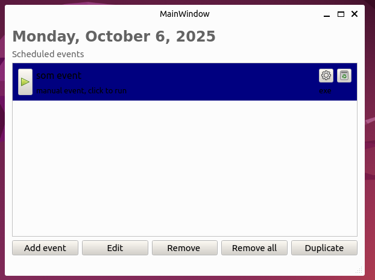
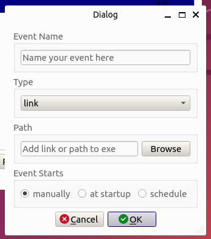

# Ulysses
Desktop app for setting up work environments based on schedule

In the main screen you have the overall list of events that can be 
scheduled and setup. 

## Add event

In the add events screen, you can create an event 
with name, type (link, executable) and path (link or path to executable).

